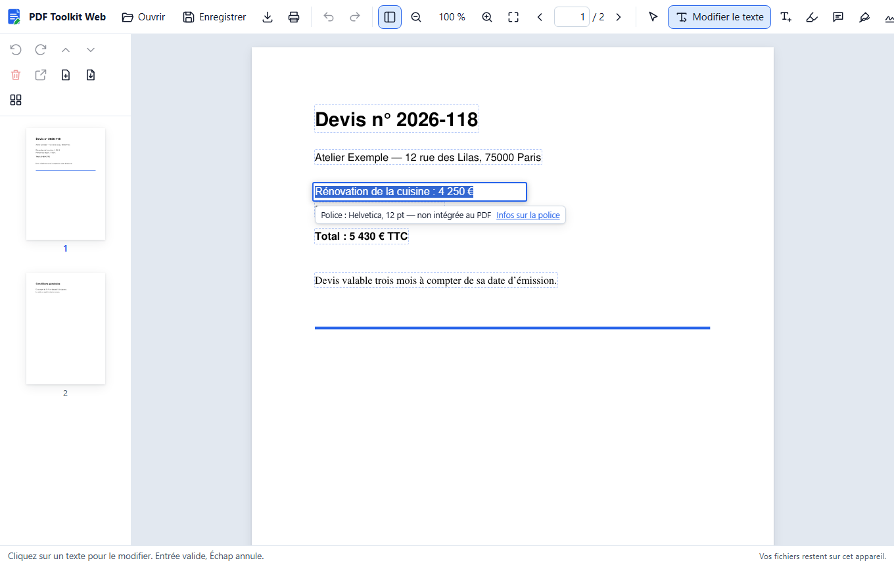
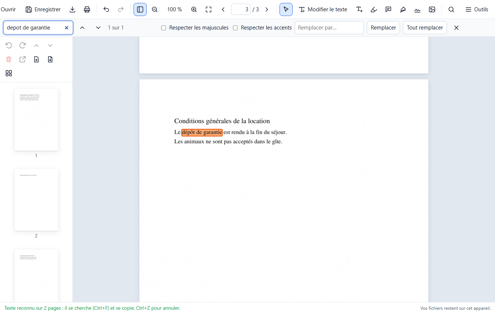

# PDF Toolkit Web

Un éditeur de PDF simple et en français qui fonctionne **entièrement dans votre navigateur** : modifier le texte,
organiser et assembler les pages, remplir les formulaires, signer, protéger par mot de passe, compresser, créer des
photos d'identité, comparer deux versions d'un document et lire le texte des documents scannés (reconnaissance de texte, OCR).

**Ouvrir le site : <https://yannickbuchet-ctrl.github.io/pdf-toolkit-web/>**

C'est la version en ligne de [PDF Toolkit 2](https://github.com/yannickbuchet-ctrl/pdf-toolkit-2), l'éditeur PDF pour
Windows, avec le même moteur : MuPDF.



## Vos documents restent chez vous

- **Rien n'est envoyé.** Le site n'a pas de serveur qui reçoit vos fichiers : le moteur MuPDF, compilé en
  WebAssembly, tourne dans votre navigateur. Vos PDF sont lus et modifiés dans la mémoire de votre appareil.
- **Aucune statistique, aucun traceur, aucune publicité.** Le site ne charge rien depuis un autre site (pas même une
  police de caractères), et sa politique de sécurité interdit d'envoyer des données ailleurs.
- **Hors ligne** : une fois le site ouvert une première fois, il continue de fonctionner sans connexion. Seuls les
  fichiers du site lui-même sont gardés par le navigateur, jamais vos documents. Deux exceptions : le lecteur des
  photos HEIC n'est téléchargé (2 Mo) qu'à la première photo HEIC, et la reconnaissance de texte (environ 2 Mo, puis
  3 Mo de plus pour l'anglais, gardés d'office) qu'à sa première utilisation ; ils sont ensuite gardés à leur tour.
- Fermer l'onglet efface tout : enregistrez votre document avant.

## Fonctions

### Lire et naviguer

- **Ouvrir** un PDF avec le bouton « Ouvrir » ou en le glissant sur la page. Les PDF protégés par mot de passe
  s'ouvrent après saisie du mot de passe.
- **Zoom** avec Ctrl + molette, Ctrl+plus et Ctrl+moins (Ctrl+0 : 100 %), ou à deux doigts sur un écran tactile.
  **Aller à une page** : Ctrl+G, ou le numéro de page dans la barre.
- **Rechercher** (Ctrl+F) sans tenir compte des accents ni des majuscules (« ete » trouve « Été ») ; F3 et Maj+F3
  passent à l'occurrence suivante ou précédente.

### Modifier et ajouter du texte

- **Modifier le texte** : bouton « Modifier le texte » (ou touche T), puis cliquez sur un texte pour le réécrire.
  L'ancien texte est vraiment retiré du fichier. La police d'origine est conservée quand c'est possible, ainsi que la
  taille, la couleur et la position. Un message indique la police utilisée et, si des lettres manquent à la police
  d'origine, lesquelles ont été prises ailleurs.
- **Rechercher et remplacer** (Ctrl+H) : une occurrence à la fois ou toutes ensemble.
- **Ajouter du texte** n'importe où sur la page, en Helvetica, Times ou Courier, à la taille et dans la couleur de
  votre choix, en gras ou en italique.
- **Infos sur les polices** (menu Outils) : nom exact, style, version, éditeur, licence, lettres présentes dans le
  PDF, et liens pour rechercher la police sur Internet ou sur Google Fonts.

### Annoter, remplir, signer

- **Annotations** : surligner, souligner ou barrer du texte, poser une note, dessiner à main levée, tracer un
  rectangle ou une ellipse. La liste des annotations de la page (menu Outils) permet d'en supprimer.
- **Formulaires** : zones de texte, cases à cocher, cases rondes à choix unique (« ○ Oui ● Non ») et listes de choix
  se remplissent directement sur la page.
- **Signatures et images** : signez à la souris, au doigt ou au stylet, ou importez une signature scannée (son fond
  blanc devient transparent) ou une image ; placez-la et redimensionnez-la sur la page. Une image peut aussi être
  glissée sur le document.
- **Formats de photo** : JPEG, PNG, **HEIC et HEIF** (photos d'iPhone et de certains Android), WebP, AVIF, GIF, BMP
  et TIFF, dans tous les navigateurs. Quand le navigateur ne connaît pas un format (le HEIC hors de Safari, le TIFF
  hors de Safari), le site le lit lui-même, sans rien envoyer. L'orientation de la photo (prise en hauteur) est
  respectée. Une photo est mise dans le PDF en JPEG, une image transparente en PNG, et un JPEG droit tel quel. Une
  photo de plus de 16 millions de pixels est réduite à cette taille, qui suffit pour imprimer une page A4 entière en
  haute qualité, et évite de saturer la mémoire d'un téléphone.

### Reconnaissance de texte (OCR)

Outils → **Reconnaissance de texte (OCR)** (Ctrl+Maj+O). Le texte des pages scannées est lu sur l'image, puis posé
dessus en **calque invisible**, mot par mot, à la place de chaque mot : la page garde son aspect, mais son texte se
**cherche** (Ctrl+F, accents compris), se **sélectionne** et se **copie** dans n'importe quel lecteur de PDF, et le
calque est gardé à l'enregistrement. Rien n'est envoyé : la lecture se fait dans le navigateur, avec le moteur
[Tesseract](https://github.com/tesseract-ocr/tesseract) compilé en WebAssembly
([Tesseract.js](https://github.com/naptha/tesseract.js)).



- **Pages** : toutes, ou une liste (« 1-3, 7 ») ; **langue** : français (par défaut), anglais, ou les deux.
- **Ignorer les pages qui contiennent déjà du texte** (coché) : les pages déjà lisibles, ou déjà passées à l'OCR,
  sont laissées telles quelles. Décochée, une page déjà passée à l'OCR est relue : son ancien texte reconnu est
  remplacé, jamais ajouté en double.
- **Redresser les pages scannées à l'envers ou d'un quart de tour** (coché) : une page qui se lit mal est essayée
  dans les quatre sens, puis pivotée pour s'afficher à l'endroit.
- La progression s'affiche page par page. **Annuler** arrête la lecture aussitôt : la page en cours n'est pas
  modifiée, les pages déjà lues gardent leur texte, et relancer l'OCR reprend où elle s'était arrêtée. **Ctrl+Z**
  annule toute l'opération d'un coup.
- À la fin, **Copier le texte** ou **Enregistrer en .txt** le texte reconnu, page par page.
- En mode « Modifier le texte », le texte reconnu, encadré en pointillés gris, **ne se modifie pas** : il est
  invisible, et un texte réécrit s'afficherait par-dessus l'image. « Remplacer » le laisse aussi tel quel. Pour le
  corriger, refaites l'OCR de la page.
- **Première utilisation** : le lecteur (1,5 Mo compressé) et les données du français (0,7 Mo) sont téléchargés depuis
  ce site, puis gardés avec les données de l'anglais (3 Mo) : l'OCR marche ensuite hors connexion, dans les deux
  langues.

Limites :

- texte imprimé seulement, en français ou en anglais : l'écriture manuscrite n'est pas lue, et un scan flou, très
  incliné ou de basse résolution (moins de 200 ppp) donne plus d'erreurs. Sur des scans de synthèse à 300 ppp (Times
  de 9 à 16 points, bruités, inclinés jusqu'à 1°), moins de 0,5 % des caractères sont faux, accents compris ; un vrai
  scan en donne davantage ;
- une page A4 se lit en une à deux secondes sur un ordinateur récent ; la lecture n'a pas été mesurée sur un vrai
  téléphone, où elle est plus lente ;
- le texte vertical (sur une page tournée qu'on choisit de ne pas redresser) n'est pas reconnu ;
- le calque d'OCR posé par un autre logiciel est gardé : relire une telle page, case « Ignorer… » décochée, ajoute le
  texte de PDF Toolkit à côté du sien ;
- les pages très grandes (affiches, plans) sont lues à une résolution réduite, pour ménager la mémoire.

### Organiser et assembler

- **Pages**, dans la colonne des miniatures : pivoter, déplacer (glisser-déposer, ou Ctrl+flèches), supprimer,
  extraire dans un nouveau PDF, insérer une page blanche ou les pages d'un autre PDF. « Organiser les pages » affiche
  les miniatures en grille.
- **Fusionner des PDF** (menu Outils) dans l'ordre de votre choix. Un PDF glissé sur le document ouvert peut être
  ajouté à la fin, ou ouvert à la place.
- **Annuler et rétablir** chaque opération : Ctrl+Z, Ctrl+Y.

### Comparer deux PDF

Menu Outils → **Comparer deux PDF**. Le document ouvert est proposé comme version A (l'ancienne) ; choisissez la
version B (la nouvelle), puis cliquez sur **Comparer**. **Inverser** échange les deux.

- **Ce qui est comparé** : le texte mot à mot (mots ajoutés en vert, supprimés en rouge, modifiés en orange) et
  l'aspect des pages (images, dessins, couleurs, mise en page : encadrés en violet, avec leur taille et leur position
  en millimètres, par exemple « zone de 0,7 × 1,4 mm à x 93,1 mm, y 50,8 mm »). Les pages ajoutées ou supprimées sont
  repérées sans décaler la suite.
- **Deux affichages** : **côte à côte**, ou **superposées** : chaque page de A et sa page de B en une seule image, ce
  qui n'est que dans A en rouge, ce qui n'est que dans B en vert, ce qui est identique en noir. Passer de l'un à
  l'autre garde l'endroit regardé.
- **La liste des différences** mène à chacune ; F3 et Maj+F3 passent à la suivante ou à la précédente.
- **Réglages** :
  - **Document** (par défaut) : pour les textes, contrats, devis…, avec une tolérance visuelle de 10 %.
  - **Plan technique (circuit, dessin)** : pour les plans et les circuits imprimés, par exemple des couches Gerber
    imprimées en PDF. Rendu deux fois plus fin, tolérance de 5 %, et deux détails qui ne se touchent pas (un via et la
    piste voisine) restent deux différences. Le nom de chaque couche (F.Cu, B.Cu, In1.Cu, F.Silkscreen, Top Layer,
    Perçages…) précède le numéro des pages.
  - Options : ignorer les majuscules, ignorer la ponctuation, comparer le texte seul ou l'aspect seul, tolérance
    visuelle réglable.
- **Rapport PDF** : synthèse, liste numérotée, pages A et B annotées, puis un gros plan de chaque différence (jusqu'à
  150) : la zone et ses abords dans A, dans B et superposés, avec sa position en millimètres.

### Photos d'identité

Menu Outils → **Photos d'identité**, à partir d'une photo (mêmes formats que ci-dessus, photos d'iPhone comprises) :

- choisissez le cadre (aux bonnes proportions, avec l'ovale du visage), redressez, faites pivoter, réglez la
  luminosité et le contraste ;
- formats France et Union européenne, Royaume-Uni, États-Unis, Canada, Chine, Japon, Australie ou sur mesure ;
  papier 10 × 15 cm, 13 × 18 cm, A6, A5, A4, Lettre ou sur mesure ;
- la planche s'imprime à la taille exacte des photos (voir « Impression » plus bas).

La photo entière et les réglages peuvent être joints au PDF pour modifier la planche plus tard (« Outils → Modifier la
planche de photos ») : décochez cette option avant de transmettre le fichier.

### Enregistrer, protéger, imprimer

- **Enregistrer** (Ctrl+S) : avec Chrome ou Edge, le PDF est écrit directement sur le fichier d'origine (le
  navigateur demande l'autorisation la première fois) ; ailleurs, il est téléchargé. **Enregistrer sous** :
  Ctrl+Maj+S.
- **Mots de passe** (menu Outils) : protection par mot de passe (chiffrement AES 256 bits) ou retrait de la
  protection.
- **Compression à l'enregistrement** : sans perte, ou forte (images réduites à environ 150 ppp et recompressées en
  JPEG) pour l'envoi par e-mail. La taille avant et après est affichée.
- **Imprimer** : Ctrl+P.

### Sur téléphone et tablette

Sur un écran étroit, la barre du haut ne garde que l'essentiel (ouvrir, enregistrer, numéro de page, annuler,
rétablir, Outils) et une barre en bas de l'écran, sous le pouce, regroupe le reste :

| Bouton | Rôle |
|---|---|
| Pages | ouvre ou ferme la colonne des miniatures |
| Modifier | mode « Modifier le texte » : touchez un texte pour le réécrire |
| Annoter | remplir les formulaires, ajouter du texte, surligner, poser une note, dessiner, signer, insérer une image |
| Chercher | rechercher et remplacer |
| Plus | zoom, ajuster à la largeur, enregistrer sous, imprimer |

La reconnaissance de texte, la fusion, la comparaison et les autres outils sont dans le menu Outils (☰), en haut à
droite. La fenêtre de l'OCR tient dans l'écran, et sa progression et son bilan restent visibles sous les options.

La page est ajustée à la largeur de l'écran dès l'ouverture ; zoomez à deux doigts. Dans la comparaison, l'affichage
« Superposées » est choisi d'office et les options se replient après le calcul (bouton « Options et fichiers » pour
les rouvrir). L'interface suit le mode clair ou sombre de l'appareil.

### Raccourcis clavier

| Touches | Action |
|---|---|
| Ctrl+O, Ctrl+S, Ctrl+Maj+S, Ctrl+P | ouvrir, enregistrer, enregistrer sous, imprimer |
| Ctrl+Z, Ctrl+Y | annuler, rétablir |
| Ctrl+F, Ctrl+H | rechercher, rechercher et remplacer |
| F3, Maj+F3 | occurrence ou différence suivante, précédente |
| Ctrl+G | aller à une page |
| Ctrl+Maj+O | reconnaissance de texte (OCR) |
| Ctrl+plus, Ctrl+moins, Ctrl+0 | zoom avant, arrière, 100 % |
| T | mode « Modifier le texte » |
| Échap | revenir à la lecture, annuler une saisie |

## Différences avec la version Windows

Un navigateur protège votre ordinateur : un site ne peut pas tout faire. Voici ce qui change.

- **Polices installées sur l'ordinateur.** Sur Windows, PDF Toolkit 2 réécrit un texte avec la police installée quand
  elle n'est pas intégrée au PDF. Un site n'y a pas accès, sauf avec **Chrome ou Edge** : dans « Outils → Infos sur
  les polices », le bouton « Utiliser les polices de cet ordinateur » le permet, avec votre autorisation. Sinon, la
  police d'origine intégrée au PDF est réutilisée, et les lettres qui lui manquent sont prises dans la police
  standard la plus proche (Helvetica, Times ou Courier, aux mêmes dimensions qu'Arial, Times New Roman et Courier New).
- **Enregistrer sur le fichier d'origine** n'est possible qu'avec Chrome et Edge. Firefox et Safari téléchargent une
  copie (dans le dossier « Téléchargements »).
- **Impression** : le navigateur imprime une image de chaque page (150 ppp, 300 ppp pour les photos d'identité). Pour
  une planche de photos d'identité, choisissez dans la fenêtre d'impression le bon papier, des marges « Aucune » et
  l'échelle « 100 % » : un site ne peut pas imposer ces réglages à l'imprimante, alors que la version Windows le fait.
  Pour un document de plusieurs formats de page, le navigateur ajuste chaque page à la feuille.
- **Photos d'identité** : l'outil « tronquer » de la version Windows n'existe pas ; les planches qui en contiennent
  sont relues correctement. En revanche, la version web lit plus de formats de photo (HEIC, WebP, AVIF). Les
  réglages joints à la planche sont écrits au même format que sur Windows (compatibilité non vérifiée dans l'autre
  sens).
- **Photos HEIC hors connexion** : le lecteur HEIC n'est gardé qu'après une première utilisation en ligne. Sans
  connexion et avant cela, une photo HEIC ne peut pas être lue (un message le dit).
- **PDF aux droits limités** (impression ou copie interdites, sans mot de passe d'ouverture) : ces limites sont
  retirées à l'enregistrement, un message le signale.
- **Taille** : tout le document est en mémoire, et chaque opération annulable en garde une copie (au plus 50 copies
  et 400 Mo). Avec un très gros PDF sur un téléphone, la mémoire peut manquer.
- **Comparaison de documents sans rapport** : quand deux PDF n'ont presque aucune suite de mots en commun, le texte
  d'un très grand bloc n'est pas comparé mot à mot (cela prendrait des minutes) : il est signalé comme supprimé et
  ajouté, page par page. Un même texte simplement coupé autrement en lignes, lui, est toujours comparé mot à mot.
- **Comparaison en cours** : elle ne peut pas être interrompue.
- **Reconnaissance de texte (OCR)** : même moteur (Tesseract, ici par Tesseract.js), mêmes données de langue, mêmes
  réglages et même calque que sur Windows. Un PDF passé à l'OCR sur l'un est reconnu par l'autre, dans les deux sens
  (vérifié) : son texte se cherche, ne se modifie pas, et la relecture remplace son calque au lieu de le doubler.
  Différences : la fenêtre ne gèle pas pendant la lecture, et Annuler arrête aussitôt (et non à la fin de la page) ;
  il n'y a pas de traitement par lots en ligne de commande (`--ocr`). Les fichiers de l'OCR ne sont pas téléchargés
  au premier chargement du site : sans connexion, l'OCR ne marche qu'après une première utilisation en ligne (un
  message le dit).
- **Comparaison superposée** : elle s'affiche une fois la comparaison faite (sous Windows, dès l'ouverture des deux
  fichiers). Une page présente dans une seule version y est montrée seule, au lieu d'être omise.
- **Rapport de comparaison** : il est écrit en Helvetica, la police standard des PDF, au lieu d'Arial : les flèches y
  deviennent « -> » et « <-> ». Les gros plans de A et de B reprennent la page en vectoriel, comme sous Windows ; la
  superposition est une image.

## Navigateurs pris en charge

Le site vise les versions récentes de **Chrome, Edge, Firefox et Safari**, sur ordinateur, tablette et téléphone :
il a besoin de WebAssembly, des Web Workers et des modules JavaScript dans les workers, présents dans tous ces
navigateurs depuis 2023. Il a été essayé avec Chromium ; Firefox et Safari n'ont pas encore été essayés. Le premier
chargement télécharge le moteur MuPDF : environ 5 Mo si le serveur le compresse (c'est le cas de GitHub Pages),
10 Mo sinon. La reconnaissance de texte ajoute, à sa première utilisation, 2 Mo (4 Mo sans compression), puis 3 Mo
pour les données de l'anglais.

## Licence

PDF Toolkit Web est distribué sous la licence **GNU AGPL v3** (voir [LICENSE](LICENSE)). Ce choix est imposé par
[MuPDF](https://mupdf.com/) (Artifex Software), sous licence AGPL : toute personne qui met ce logiciel à
disposition, y compris sur un site web, modifié ou non, doit aussi en publier le code source.

Code source : [github.com/yannickbuchet-ctrl/pdf-toolkit-web](https://github.com/yannickbuchet-ctrl/pdf-toolkit-web).

Licences des composants tiers : [LICENCES-TIERCES.md](LICENCES-TIERCES.md).

## Crédits

- Application écrite par **Claude Code** (Claude Opus 5.5) sous la direction de **Yannick Buchet**.
- [MuPDF et MuPDF.js](https://mupdf.com/) (Artifex Software, AGPL) pour le traitement des PDF.
- [libheif](https://github.com/strukturag/libheif) et libde265 (struktur AG, LGPL), par
  [libheif-js](https://github.com/catdad-experiments/libheif-js), pour les photos HEIC.
- Reconnaissance de texte : [Tesseract](https://github.com/tesseract-ocr/tesseract), par
  [Tesseract.js](https://github.com/naptha/tesseract.js), et ses données de langue (Apache 2.0).

---

## Développer

### Installer

Il faut [Node.js](https://nodejs.org/) 22 ou plus récent (avec npm). Sous Windows, prenez l'installateur « LTS » sur
nodejs.org, ou, sans droits d'administrateur, l'archive zip « Windows Binary » décompressée dans un dossier de votre
choix, que vous ajoutez au `PATH` de la session :

```powershell
$env:Path = "C:\chemin\vers\node;$env:Path"
node -v
```

Puis, dans le dossier du projet :

```
npm install
```

### Lancer en développement

```
npm run dev
```

Vite affiche l'adresse locale (par défaut <http://localhost:5173>).

### Tester

```
npm test                              # tests de la logique (Vitest, MuPDF WebAssembly dans Node)
npm run build                         # vérification TypeScript, puis construction dans dist/
npx playwright install chromium       # une seule fois : navigateur sans fenêtre
node scripts/parcours-navigateur.mjs  # parcours dans le site construit, captures dans captures/
node scripts/essai-images.mjs         # formats de photo dans le site construit (dist/essai-images/)
node scripts/essai-ocr.mjs            # reconnaissance de texte dans le site construit (captures/ocr-*.png)
```

`scripts/essai-ocr.mjs` passe à l'OCR, dans Chromium, un PDF de trois pages fabriqué pour l'essai (un scan accentué,
une page de vrai texte, un scan à l'envers), puis vérifie : bilan, page déjà textuelle laissée telle quelle, page
redressée, recherche sans accents, texte reconnu non modifiable ni remplaçable, Ctrl+Z et Ctrl+Y, OCR refaite sans
doublon, arrêt en cours de lecture, Ctrl+Maj+O, texte copié et enregistré en .txt, PDF enregistré relu. Puis sur
téléphone, et hors connexion après une première utilisation (en français, puis en anglais). Il vérifie aussi que les
fichiers de l'OCR ne sont téléchargés qu'à sa première utilisation, et qu'aucune requête ne quitte le site.

`scripts/essai-images.mjs` insère dans Chromium une photo HEIC d'iPhone (sur ordinateur et sur téléphone), un TIFF,
une photo JPEG de 24 Mpx tournée par son EXIF, un PNG transparent et une photo HEIC déposée sans type de fichier,
puis relit le PDF enregistré : orientation, format (JPEG ou PNG avec transparence), réduction à 16 Mpx. Il ouvre aussi
les photos d'identité depuis une photo HEIC, vérifie que le site et le lecteur HEIC marchent hors connexion après une
seule visite, et qu'aucune requête ne quitte le site. On peut lui donner une grande photo HEIC pour mesurer le temps
de lecture : `node scripts/essai-images.mjs photo.heic`.

Les tests créent leurs propres PDF (aucun document personnel n'est utilisé) et relisent les fichiers produits :
modification du texte (police standard, police intégrée complète, police réduite, TrueType, accents, page pivotée),
pages, fusion, mots de passe, compression, formulaires, annotations, recherche, dimensions exactes des photos
d'identité et lecture sûre de leurs réglages, comparaison et rapport, formats d'image (reconnaissance du format,
photo HEIC tournée lue par libheif, TIFF et JPEG en CMJN convertis par MuPDF), reconnaissance de texte avec
Tesseract.js dans Node, sur des scans de synthèse (`tests/scan.ts`) : accents, bruit et inclinaison, page pivotée par
le fichier, page à l'envers redressée, page déjà textuelle ignorée, OCR refaite sans doublon, arrêt puis reprise,
page blanche, page inchangée à l'affichage, français et anglais ensemble. La seule image d'essai enregistrée,
`tests/images/quadrants-quart-de-tour.heic`, est un damier de quatre couleurs fabriqué avec pillow-heif.

Si le dossier `Exemples Gerber` existe à côté du projet (deux révisions d'une carte de circuit imprimé, avec la liste
des modifications faites), `tests/comparaison-gerber.test.ts` compare les deux cartes A4 et vérifie que chaque
modification est trouvée, sur chacune de ses pages, sans fausse alerte (réglage « Plan technique » : 24 différences,
aucune manquée ; réglage « Document » : seul le perçage agrandi de 0,05 mm échappe), ainsi que les noms des couches,
la superposition et les gros plans du rapport. Le parcours dans le navigateur compare aussi ces cartes, sur ordinateur
et sur téléphone. Sans ce dossier, ces essais sont sautés.

### Construire

```
npm run build
```

Le résultat, `dist/`, est un site statique aux chemins relatifs : il peut être servi depuis n'importe quel dossier.
Pour fixer un chemin de base (sous-dossier d'un site) : `BASE=/pdf-toolkit-web/ npm run build`
(PowerShell : `$env:BASE = "/pdf-toolkit-web/"; npm run build`). `npm run preview` sert `dist/` en local.

Le service worker (`public/sw.js`) n'est actif que sur HTTPS ou `localhost`. À la construction, `vite.config.ts`
écrit la liste des fichiers du site dans `dist/hors-ligne.json`, que le service worker garde dès son installation
(hors ligne dès la première visite), et donne à son cache un nom tiré de cette liste : chaque nouvelle version
remplace l'ancienne, sans rien changer à la main. Le lecteur HEIC est laissé hors de la liste.

Les fichiers de la reconnaissance de texte sont copiés par `vite.config.ts` depuis `node_modules` dans un dossier
`dist/ocr-<empreinte>/` (le nom change avec leur contenu) : le Web Worker de Tesseract.js, son moteur WebAssembly en
trois versions (le navigateur n'en télécharge qu'une, selon son processeur) et les données `fra` et `eng`
(`@tesseract.js-data`, modèles « best_int »). `hors-ligne.json` les liste à part (`ocr`) : le service worker ne les
garde qu'à la première reconnaissance de texte. En développement, `npm run dev` les sert depuis `node_modules`.

### Déployer sur GitHub Pages

Le fichier `.github/workflows/pages.yml` teste, construit et publie le site sur GitHub Pages. Il ne se lance que
manuellement (onglet « Actions » → « Publier sur GitHub Pages » → « Run workflow »). Avant la première publication :

1. créer le dépôt sur GitHub et y pousser la branche `main` ;
2. dans Settings → Pages, choisir la source « GitHub Actions » ;
3. si le dépôt change d'adresse, la mettre à jour dans `src/version.ts` (`CODE_SOURCE`) et dans ce README.

### Organisation du code

| Dossier ou fichier | Rôle |
|---|---|
| `src/moteur/` | logique PDF avec MuPDF : texte (`texte.ts`, `polices.ts`, `segments.ts`, `tableUnicode.ts`), document et pages, compression, photos d'identité, comparaison et rapport, images que le navigateur ne lit pas (`images.ts`), reconnaissance du format d'une image (`formatImage.ts`) |
| `src/worker.ts` | le moteur dans un Web Worker : documents ouverts, annuler et rétablir |
| `src/heic.worker.ts` | le lecteur de photos HEIC (libheif en WebAssembly), dans un Web Worker créé à la demande |
| `src/moteur/ocr.ts`, `src/moteur/ocrLecture.ts` | reconnaissance de texte : image des pages et calque invisible (MuPDF) ; lignes, sens de lecture, déroulé et bilan (sans MuPDF) |
| `src/ui/ocr.ts` | la fenêtre de l'OCR et Tesseract.js, chargés à la première utilisation |
| `src/ui/` | l'interface : application, outils et fenêtres, lecture des images (`images.ts`), photos d'identité, comparaison |
| `tests/` | tests Vitest, fabrique de PDF de test, scans de synthèse (`scan.ts`), photo HEIC d'essai (`tests/images/`) |
| `scripts/parcours-navigateur.mjs` | parcours dans Chromium sans fenêtre |
| `scripts/essai-images.mjs` | formats de photo dans Chromium sans fenêtre |
| `scripts/essai-ocr.mjs` | reconnaissance de texte dans Chromium sans fenêtre |
| `public/` | service worker, manifeste et icône |

À noter pour MuPDF.js 1.28 (vérifié par les tests) : enregistrer le document de travail avec des options
`garbage` ou `encrypt` le modifie en mémoire et l'abîme si on recommence ; l'application enregistre donc toujours
une copie fraîche (`enregistrerCopie`). Et `garbage=3` ou plus peut fusionner à tort deux formulaires XObject
semblables : l'application s'en tient à `garbage=2`.
